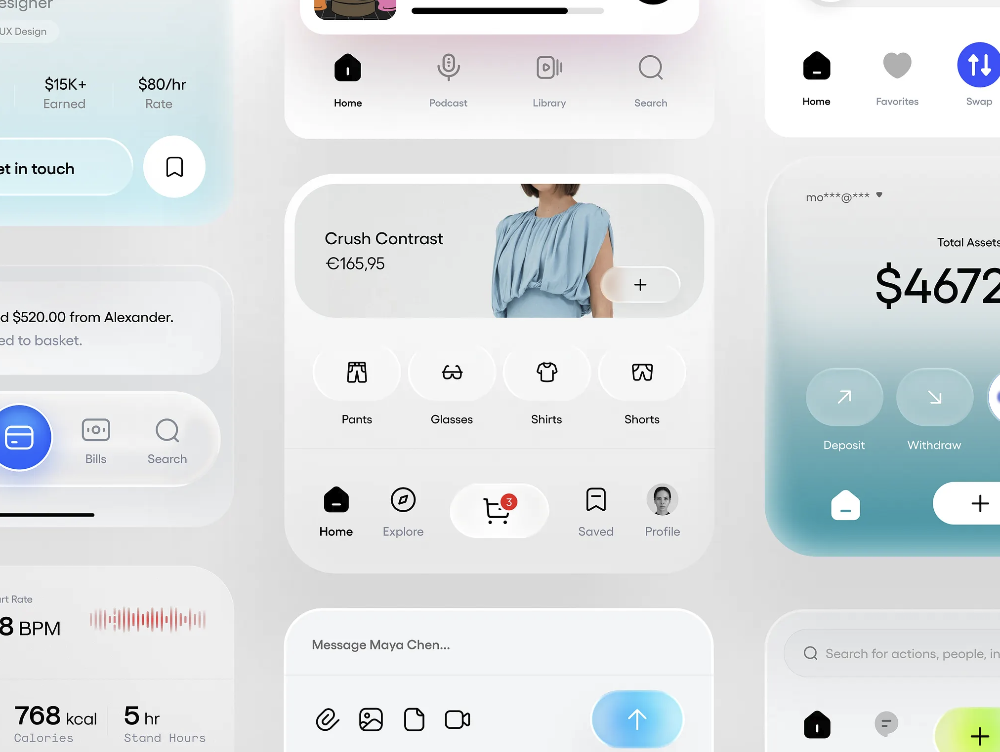

# 桌面喝水与休息提醒助手 PRD

**文档版本**：V1.0  
**状态**：初稿  
**日期**：2026-08-01  
**产品形态**：macOS 桌面端常驻工具（后续再评估 Windows）

## 1. 产品概述

这是一个常驻桌面的轻量健康提醒工具：用户可以设定喝水和休息计划，到点后通过 macOS 通知、轻量弹窗或菜单栏提示进行提醒；同时，用户可以上传宠物或人物照片，系统自动生成保持主体外观一致的多种动作和视角，用作提醒时的角色形象。

产品重点不是记录复杂的健康数据，而是让提醒“准时、可执行、愿意回应”。个性化宠物形象承担情绪价值和记忆点，让用户更愿意完成一次喝水或休息。

## 2. 背景与用户问题

### 2.1 用户问题

- 长时间工作、学习或刷屏时容易忘记喝水。
- 久坐和连续盯屏导致疲劳，但传统提醒往往过于打扰，容易被关闭后遗忘。
- 普通系统通知缺少个性化，用户对提醒没有情感连接。
- 用户希望使用自己的猫咪、狗狗等作为陪伴角色，但单张照片无法覆盖“挥爪、打哈欠、趴下休息”等场景。

### 2.2 产品机会

- 将固定时间提醒升级为“可回应的微习惯引导”。
- 用用户熟悉的个性化形象降低提醒的机械感和打扰感。
- 通过离线优先、低资源常驻，适合桌面工作流。

## 3. 产品目标与非目标

### 3.1 目标

1. 让用户在 3 分钟内完成首次提醒设置。
2. 让用户能在提醒出现后，用一次点击完成“喝了 / 稍后 / 跳过”的反馈。
3. 让用户通过 1–10 张宠物照片，或人物照片，生成一组可用于提醒的稳定角色素材。
4. 在不显著打断工作的前提下，提高喝水与休息提醒的完成率。

### 3.2 非目标（MVP 不做）

- 不提供医疗诊断、疾病建议或个体化饮水处方。
- 不替代专业运动、睡眠或健康管理 App。
- 不强制接入智能水杯、摄像头或可穿戴设备。
- 不承诺仅凭照片生成 100% 完全一致的宠物身份；需提供人工筛选和重生成机制。

## 4. 目标用户与典型场景

### 4.1 目标用户

- 久坐办公的知识工作者、设计师、程序员、自由职业者。
- 长时间学习、备考或居家办公的人群。
- 喜欢宠物、愿意进行轻量个性化设置的用户。

### 4.2 典型场景

**场景 A：喝水**  
用户设置工作日 09:00–18:00 每 45 分钟提醒一次。提醒出现时，桌面角落出现宠物挥爪插画和“该补水啦”文案。用户点击“已喝水”，本轮结束并进入下一轮。

**场景 B：休息**  
用户设置每 50 分钟工作、休息 10 分钟。提醒出现时，宠物做伸懒腰动作，提示用户离开屏幕。用户可开始休息计时，或延后 5 分钟。

**场景 C：个性化形象**  
用户上传 3 张猫咪照片，系统识别主要外观特征，生成正面、侧面、趴卧、挥爪、喝水、打哈欠等候选形象。用户选择 6 张加入提醒素材库。

## 5. 产品原则

- **轻打扰**：提醒必须可忽略、可延后，不阻断用户当前任务。
- **一键完成**：从提醒到反馈尽量不超过一次点击。
- **陪伴感优先**：个性化形象和文案应温和、可爱，但不制造负罪感。
- **可控可信**：AI 生成结果必须可预览、可删除、可重新生成；默认不公开上传内容。
- **低资源常驻**：无提醒时尽量不占用 CPU、内存和网络。

## 5.1 界面风格参考

以下图片作为界面风格参考，重点借鉴其“简洁、柔和、精致”的感觉，不直接复制具体页面内容：

### 视觉方向

- **整体气质**：简洁、轻盈、漂亮，有陪伴感但不幼稚。
- **布局**：以留白和大圆角卡片组织信息，首页只突出下一次提醒和今日完成状态。
- **色彩**：以米白、浅灰、雾蓝为基础色，喝水使用清透蓝色，休息使用柔和绿色或淡紫色作为强调色。
- **材质**：允许轻微半透明和柔和渐变，但避免过度玻璃拟态，确保文字和按钮可读。
- **图标**：使用简洁的黑 / 深灰线性图标，保持统一线宽；宠物或人物形象作为局部视觉焦点。
- **控件**：按钮和输入控件采用大点击区域、轻边框和克制阴影；不使用复杂表格或拥挤的设置面板。
- **动效**：提醒出现和卡片切换使用短时、低幅度动效；不做持续闪烁或强制吸引注意的动画。

## 6. 核心用户流程

### 6.1 首次使用

1. 安装并启动应用。
2. 选择“喝水”“休息”或两者同时开启。
3. 选择推荐计划，或自定义开始时间、结束时间、间隔。
4. 可选：上传宠物或人物照片并生成提醒形象；也可先使用默认形象。
5. 系统请求通知权限，用户完成授权。
6. 应用缩小至系统托盘 / 菜单栏，开始按计划工作。

### 6.2 提醒反馈

1. 到达计划时间，显示系统通知；若用户开启增强提醒，显示带宠物形象的轻量浮层。
2. 提供操作：`已完成`、`稍后 5 分钟`、`跳过`。
3. 用户点击 `已完成` 后记录本轮完成；点击 `稍后` 后按延后时间再次提醒；点击 `跳过` 后记录为跳过，不连续追问。
4. 休息提醒可额外提供 `开始 10 分钟休息`，启动倒计时。

### 6.3 形象生成

1. 用户从“设置 > 提醒形象”进入形象管理，也可从首页或提醒计划页快捷进入。
2. 用户选择形象类型：宠物或人物；宠物档案最多上传 10 张照片，人物档案 MVP 支持 1–5 张照片。
3. 系统提示拍摄建议：光线清晰、主体完整、尽量包含正面或侧面；多张宠物照片建议覆盖不同角度和姿态。
4. 系统生成角色基准（外观特征摘要 + 参考图），并展示预计生成时间。
5. 用户选择动作 / 视角 / 情绪 / 背景风格，可多选。
6. 系统批量生成候选图，并以网格展示。
7. 用户可 `加入素材库`、`重新生成`、`删除` 或 `设为默认`。
8. 素材被提醒引擎按场景随机或按用户规则调用。

## 7. 功能需求

### 7.1 提醒计划（P0）

| 编号 | 需求 | 说明 | 优先级 |
|---|---|---|---|
| R-01 | 创建提醒 | 支持喝水、休息两类提醒；可分别开关 | P0 |
| R-02 | 时间范围 | 设置开始时间、结束时间、工作日 | P0 |
| R-03 | 间隔设置 | 支持按固定间隔（如 30/45/60 分钟）提醒 | P0 |
| R-04 | 自定义时刻 | 支持添加多个固定时刻，适合会议或服药式节奏 | P1 |
| R-05 | 休息模式 | 支持“工作 X 分钟 + 休息 Y 分钟”循环 | P0 |
| R-06 | 暂停计划 | 暂停今天、暂停至指定日期、永久关闭 | P0 |
| R-07 | 快速调整 | 托盘菜单可暂停、延后下一次提醒、立即测试提醒 | P0 |
| R-08 | 冲突处理 | 喝水与休息同一时间触发时合并为一条提醒 | P1 |
| R-09 | 设置页入口 | 设置页提供“提醒时间”和“提醒形象”两个清晰入口；形象入口可进入上传、生成和素材管理 | P0 |

**默认建议**：首次进入时给出“工作日 09:00–18:00，每 45 分钟喝水；每 50 分钟休息 10 分钟”的可编辑模板，不把建议包装成医疗结论。

### 7.2 提醒呈现与反馈（P0）

| 编号 | 需求 | 说明 | 优先级 |
|---|---|---|---|
| N-01 | 系统通知 | 使用 macOS 原生通知，包含标题、用户自定义文案、提醒形象缩略图（系统支持时） | P0 |
| N-02 | 轻量浮层 | 可选右下角 / 右上角浮层，不抢焦点、不强制置顶；浮层必须有明确的 `关闭` / `×` 入口 | P0 |
| N-03 | 动作按钮 | 已完成、稍后、跳过；休息增加开始休息 | P0 |
| N-04 | 声音与震动 | 支持静音、低音量、系统默认音效；桌面端无震动时不展示该选项 | P1 |
| N-05 | 防骚扰 | 用户处于全屏演示、游戏或专注模式时遵循系统勿扰设置 | P1 |
| N-06 | 反馈记录 | 记录触发、完成、延后、跳过和响应耗时 | P0 |
| N-07 | 手动关闭 | 用户点击通知或浮层的关闭入口后，本次提醒立即消失；关闭不等同于完成，需按“未响应 / 关闭”记录 | P0 |

### 7.3 提醒形象管理（P0）

| 编号 | 需求 | 说明 | 优先级 |
|---|---|---|---|
| A-01 | 形象类型 | 支持创建“宠物”或“人物”形象档案；每个档案可设为提醒默认形象 | P0 |
| A-02 | 上传照片 | 支持 JPG、PNG、HEIC；单张建议小于 10MB；宠物档案最多 10 张，人物档案 MVP 最多 5 张 | P0 |
| A-03 | 多图管理 | 支持继续添加、删除、替换和调整参考图；显示已上传数量（如 `6/10`） | P0 |
| A-04 | 质量检查 | 检测主体过小、遮挡严重、模糊、多人 / 多宠物等情况并提示；多图档案检查是否为同一主体 | P0 |
| A-05 | 角色基准 | 从照片提取毛色、脸型、花纹、眼睛、发型、脸部轮廓等特征，生成可复用角色基准 | P0 |
| A-06 | 动作与视角模板 | 首批提供挥爪、喝水、打哈欠、伸懒腰、趴卧、开心、困倦；正面、侧面、背面、俯视 | P0 |
| A-07 | 批量生成 | 一次选择多个动作 / 视角，批量生成 4–12 张候选图 | P0 |
| A-08 | 素材筛选 | 预览、加入素材库、删除、设为默认、按场景绑定 | P0 |
| A-09 | 重生成 | 支持对单张结果重生成；保留原始照片和角色基准 | P0 |
| A-10 | 素材分类 | 按喝水、休息、通用、收藏分类 | P1 |
| A-11 | 生成进度 | 显示排队、生成中、成功、失败；失败支持重试 | P0 |

### 7.4 设置与数据（P0）

- 设置页是提醒相关配置的统一入口，至少包含“提醒时间”“提醒形象”“通知与声音”“隐私与数据”四个分区。
- “提醒时间”分区可直接查看和编辑喝水 / 休息计划；保存后展示下一次触发时间。
- “提醒形象”分区可创建人物或宠物档案、上传参考照片、进入生成工作台、选择默认形象和管理素材。
- 宠物上传区必须明确展示最多 10 张的限制、当前数量和添加入口；达到上限后禁用继续添加并提供删除 / 替换操作。
- “提醒文案”分区允许分别编辑喝水和休息的通知标题、正文和按钮文案，并提供恢复默认文案和发送测试提醒。
- 自定义文案需限制长度、过滤空文本；未设置时使用产品默认文案。文案预览必须同时展示通知和浮层两种形态。
- 菜单栏 / 系统托盘常驻，支持开机启动。
- 支持通知权限、声音、浮层位置、语言、深色模式等设置。
- 提醒历史默认仅保存在本机；支持导出 CSV / JSON（P1）。
- 用户可随时删除原始照片、角色基准和生成素材；删除后不可恢复需二次确认。
- 云端生成前明确展示上传提示、隐私说明和数据保留期限。

### 7.5 macOS 顶部菜单与快捷入口（P0）

- 应用打开后使用 macOS 原生顶部菜单栏，菜单栏中必须提供 `设置…` 入口。
- 建议菜单结构：`喝水助手`（关于、设置、退出）、`提醒`（暂停 / 恢复、立即测试）、`窗口`（显示今日面板、隐藏窗口）、`帮助`。
- `设置…` 支持标准快捷键 `⌘,`；菜单项点击后直接打开设置页，不要求用户先进入托盘菜单。
- 应用主窗口顶部可保留一个简洁的齿轮图标作为第二入口，但不能替代 macOS 顶部菜单栏入口。
- 菜单栏图标用于快速查看下一次提醒、暂停今天、延后下一次提醒和打开设置。

## 8. AI 形象生成方案

### 8.1 体验要求

- 用户不需要理解“模型”“LoRA”等技术概念，只看到“上传照片 → 选择动作 → 生成”。
- 首次生成应给出可接受的第一批结果；不要求用户反复调参。
- 生成结果必须标注“AI 生成”，避免用户误以为是原始照片。

### 8.2 生成策略（产品层）

1. **角色基准建立**：对用户照片做主体检测、去背景 / 裁切建议、特征摘要和参考图整理；同一宠物的多张照片合并为一个角色基准，以提升外观一致性。
2. **模板化提示**：动作、视角、情绪、背景均使用预设模板；高级用户可填写补充描述（P1）。
3. **一致性约束**：宠物优先保留脸部花纹、毛色、耳朵形状、尾巴特征；人物优先保留脸部轮廓、发型、肤色和明显特征；每次生成使用同一角色基准。
4. **安全过滤**：拦截明显异常、肢体变形、非目标主体和不适宜内容。
5. **人工选择兜底**：生成不满意时支持换动作、换视角、重生成，不能自动覆盖用户已选素材。

### 8.3 生成失败与降级

- 网络不可用：继续使用已下载的素材和默认形象；新生成任务进入待处理队列。
- 云端服务超时：展示预计等待和重试入口，不阻塞提醒功能。
- 结果质量不达标：允许用户标记“主体不像原照片”，用于本次重生成参数调整。
- 用户不上传照片：使用内置默认角色，不影响核心提醒。

### 8.4 开发、服务器与上架方案

#### macOS 首版范围

- 首版只做 macOS，优先采用原生 macOS 交互：顶部菜单栏、菜单栏常驻、系统通知、开机启动和系统深色模式。
- 提醒计划、提醒记录、设置项和已选素材默认保存在本机；关闭主窗口不应停止提醒。
- 首版不强制账号体系，不做跨设备同步，降低开发、隐私和服务器成本。

#### 服务器策略

- **提醒功能不需要服务器**：本地定时器和本地存储即可完成时间计算、通知触发和反馈记录。
- **AI 生成需要远程能力时再使用服务器**：图像生成通常需要调用云端模型或远程推理服务。客户端不直接内置长期有效的模型密钥，避免密钥泄露。
- MVP 采用“本地优先 + 轻量无状态网关”的方案：客户端上传经过用户确认的参考图，网关转发到图像生成服务，返回结果后客户端保存已选素材；网关不保存用户数据或仅做短时缓存并自动删除。
- 开发阶段可使用开发环境密钥；正式发布前再接入按量计费、免费额度或自托管的生成服务。免费额度和服务政策需在上线前重新核对，不把特定供应商或价格写死在产品逻辑中。
- 如果暂时不接入 AI 服务，产品仍必须支持默认形象、手动上传素材和完整的提醒功能，不能因生成服务不可用而影响提醒。

#### 上架与发布路线

1. **开发 / 内测**：本地运行和签名测试，验证通知权限、菜单栏、休眠恢复和开机启动。
2. **外部测试**：提供可撤销的测试安装包，收集提醒准时率、关闭率和 AI 生成质量反馈。
3. **正式发布**：根据目标用户选择 Mac App Store 或官网下载安装包；两种渠道都需要在发布前完成签名、公证、隐私说明和权限文案准备。
4. **后续更新**：客户端更新与 AI 服务解耦；即使服务器暂时不可用，已安装版本仍能继续执行本地提醒。

上架相关的开发者账号、签名、公证、审核政策和生成服务费用，以正式发布时的官方要求为准；PRD 当前只锁定产品能力和降级策略，不预设具体供应商。

## 9. 信息架构与页面

1. **今日面板**：下一次提醒、今日完成率、快速暂停 / 延后、最近反馈。
2. **提醒计划**：喝水计划、休息计划、工作日与时间范围、模板管理。
3. **提醒形象**：人物 / 宠物档案、照片上传、生成入口、素材库、按场景绑定。
4. **生成工作台**：照片检查、动作 / 视角选择、生成进度、候选结果。
5. **设置**：提醒时间、提醒文案、提醒形象、通知与声音、开机启动、隐私、数据删除、关于。

## 10. 关键交互与文案示例

### 10.1 喝水提醒

- 标题：`猫咪提醒你喝口水`
- 正文：`忙完这一段了吗？喝几口水再继续吧。`
- 按钮：`已喝水` / `5 分钟后提醒` / `跳过`

### 10.2 休息提醒

- 标题：`和猫咪一起离开屏幕 10 分钟`
- 正文：`伸伸肩、看看远处，让眼睛休息一下。`
- 按钮：`开始休息` / `5 分钟后提醒` / `跳过`

### 10.3 生成失败

- 标题：`这次没把猫咪画像`
- 正文：`可以换一张更清晰的照片，或者直接重新生成。`
- 按钮：`重新生成` / `换照片` / `稍后处理`

### 10.4 自定义文案

- 用户可在设置中把喝水提醒改成：`提醒我喝水`。
- 用户可在设置中把休息提醒改成：`提醒我休息`。
- 保存自定义文案后，下一次系统通知和浮层均使用新文案；设置页提供“发送测试提醒”验证效果。
- 每条文案均保留默认值，用户清空或恢复默认后回到产品默认文案。

## 11. 数据与隐私要求

- 原始照片、角色基准、生成素材按用户档案隔离存储。
- 默认不用于训练、不公开、不与其他用户共享；上传前以清晰文案告知。
- 传输使用 HTTPS；本地敏感数据使用系统安全存储能力。
- 提供“一键删除全部形象数据”和“仅删除云端副本”两种操作（如技术架构支持）。
- 明确第三方图像生成服务的处理主体、存储位置、保留时间和删除方式。
- 涉及未成年人、他人肖像或他人宠物照片时，需在隐私说明中提示用户确认拥有使用权限。

## 12. 指标与验证

### 12.1 北极星指标

**每周有效完成提醒次数**：用户点击“已喝水”或完成一次休息计时的提醒次数。

### 12.2 核心指标

- 首次设置完成率 ≥ 80%。
- 首次设置耗时中位数 ≤ 3 分钟。
- 提醒响应率（已完成 / 触发）≥ 35%（上线后按人群校准）。
- 延后后最终完成率 ≥ 50%。
- 7 日留存 ≥ 30%。
- 上传照片后成功选入素材库的用户比例 ≥ 60%。
- 生成结果“不像我的宠物”反馈率 ≤ 25%。
- 因提醒过度打扰而关闭全部计划的比例 ≤ 10%。

### 12.3 质量指标

- 提醒触发准时率：计划时间 ±30 秒内 ≥ 99%。
- 应用空闲 CPU 占用目标 ≤ 1%，内存目标 ≤ 150MB（设备差异需校准）。
- 生成任务成功率 ≥ 95%；失败任务可重试且不影响提醒。

## 13. 版本规划

### MVP（P0）

- macOS 顶部菜单栏 `设置…` 入口、菜单栏常驻和 `⌘,` 快捷键。
- 喝水 / 休息计划创建、编辑、暂停，以及自定义提醒文案。
- macOS 系统通知 + 带明确关闭入口的轻量浮层。
- 已完成 / 稍后 / 跳过反馈和本地记录。
- 人物 / 宠物照片上传、质量检查、模板化动作与视角生成；宠物单档案最多 10 张参考图。
- 候选图筛选、素材库、默认形象。
- 菜单栏常驻、通知权限、隐私与删除；提醒和基础设置在无服务器时也可用。

### V1.1（P1）

- 自定义固定时刻、场景化素材绑定、提醒统计趋势。
- 导出记录、跨设备同步、全屏 / 会议状态适配。
- 高级文案和生成参数（服饰、场景、画风）。

### V2（探索）

- 多宠物档案和家庭成员共享。
- 根据用户响应情况自适应调整提醒密度（需明确授权）。
- 智能水杯、健康平台或系统专注模式联动。
- 宠物形象动态化 / 短动画 / 语音提醒。

## 14. 关键风险与应对

| 风险 | 影响 | 应对 |
|---|---|---|
| AI 生成与原宠物差异大 | 用户失去信任和情感价值 | 多图输入、角色基准、候选筛选、重生成和“不像”反馈 |
| 提醒过多造成反感 | 用户关闭产品 | 默认轻量、支持延后 / 暂停、遵循系统勿扰、监控关闭率 |
| 云端生成带来隐私顾虑 | 用户不愿上传 | 上传前明确告知、默认不训练、删除入口、离线提醒不受影响 |
| 系统休眠或权限导致漏提醒 | 核心价值受损 | 启动时补偿检查、权限检测、异常状态提示、准时率监控 |
| 生成服务成本不可控 | 毛利和可持续性受影响 | 首批免费额度、按批次生成、缓存素材、限制并发和图片尺寸 |

## 15. MVP 验收标准

1. 用户可在首次启动流程内完成至少一个提醒计划，并明确看到下一次提醒时间。
2. 应用退出主窗口后仍可在菜单栏运行，计划时间到达时能收到 macOS 通知；通知和浮层均有明确关闭入口。
3. 用户可从 macOS 顶部菜单的 `设置…` 或 `⌘,` 打开设置页，并能修改提醒时间、提醒文案和提醒形象。
4. 用户可从提醒中完成、延后或跳过，状态在今日面板中可见；手动关闭记录为“关闭 / 未响应”，不误记为完成。
5. 用户从设置页进入“提醒形象”后，可创建人物或宠物档案；上传清晰宠物照片时最多可添加 10 张，并能看到当前数量和上限。
6. 用户能选择至少 6 个动作 / 视角组合并获得候选结果；生成结果可预览、删除、重生成和设为默认，已选素材可在后续提醒中稳定调用。
7. 无网络、无服务器或生成失败时，已有提醒与本地素材仍可正常工作。
8. 用户能找到隐私说明和删除入口，并能完成原始照片及生成素材的删除。
9. 关键埋点、错误日志和准时率数据可用于上线后验证指标。

## 16. 待决策问题

- macOS 首版验证达到什么指标后，再启动 Windows 版本评估？
- 生成服务采用云端 API、私有部署还是混合方案？
- 宠物照片上限是否长期固定为 10 张，还是按套餐 / 设备能力调整？
- 首次正式发布选择 Mac App Store 还是官网下载安装包，或同时支持两种渠道？
- AI 生成服务的免费额度、地区可用性和隐私条款是否满足上线要求？
- 默认提醒频率是否需要按“轻量 / 标准 / 积极”提供三档？
- 产品是否需要账号体系，还是先做无账号本地优先？
