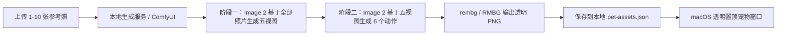

# 桌面猫咪生成与提醒技术方案

## 目标

用户上传最多 10 张宠物照片后，App 不应该简单抠图、拉伸或旋转原图，而应该通过生成模型归纳“同一只猫”的身份，并生成可以显示在 macOS 桌面右上角的透明小宠物素材。

## 正确生成流程



## 阶段一：五视图

输入是用户上传的 1-10 张参考照。Image 2 图像到图像模型需要综合全部照片，生成同一只猫的 5 张全新透明背景视图：

- 正面视图
- 左侧视图
- 右侧视图
- 安静姿态
- 动态姿态

关键要求：

- 保持同一只猫的毛色、花纹、脸型、眼睛、耳朵、尾巴和体型。
- 不是从上传照片里挑 5 张，也不是抠图、镜像、旋转或仿射变形。
- 必须返回 5 张全新图片，不能直接返回、裁剪、镜像、旋转或变形上传原图。
- 输出应为透明 PNG；如果模型不支持透明背景，应在后处理阶段抠图。

## 阶段二：六个动作

输入是阶段一生成的五视图，再次调用 Image 2 生成 6 个桌面提醒动作：

- 挥手提醒
- 趴下休息
- 侧身看看
- 伸懒腰
- 安静陪伴
- 眨眼提示

关键要求：

- 六个动作必须共享同一只猫身份。
- 六个动作必须基于阶段一的新五视图，保持同一只猫身份，而不是来自上传原图。
- 适合显示在桌面右上角。
- 不要生成杯子、水杯或复杂道具。
- 输出透明 PNG。

## 本地免费模型建议

为了公开到 GitHub 后让别人也能使用，默认方案不绑定付费云 API。

推荐：

- ComfyUI
- OpenAI GPT Image 2 `/v1/images/edits` 工作流
- IP-Adapter / Redux / LoRA 可作为身份一致性辅助
- rembg / RMBG 做透明背景

App 侧只约定输入输出协议，具体模型工作流由本地生成服务实现。详见 [local-generation-engine.md](./local-generation-engine.md)。

## macOS 桌面 App

当前 Electron 桌面壳负责：

- Tray 菜单栏图标：点击打开设置。
- 设置窗口：上传照片、设置提醒间隔、编辑提醒正文。
- 顶层生成进度：保存后常驻显示生成状态。
- 宠物浮窗：透明、无边框、置顶、显示在所有工作区。
- 提醒气泡：
  - 已完成：关闭本次提醒。
  - 稍后：15 分钟后再次提醒。
  - 叉号：关闭本次提醒。

## 打包与安装

不走 App Store。

```bash
npm run desktop:build
```

输出目录：

```text
release/
```

## 重要原则

- 不在前端保存或暴露 API key。
- 不提交用户照片。
- 不用“抠图 + 变形”冒充模型生成。
- 生成服务没配置好时，明确提示用户，而不是返回假素材。
